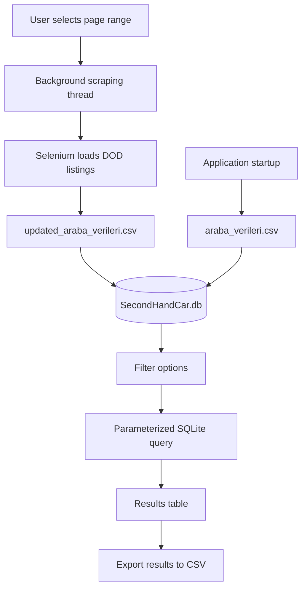

# Second-Hand Car Validation and Management System

[](https://www.python.org/)
[](https://pypi.org/project/PyQt5/)
[](https://www.sqlite.org/)
[](https://www.selenium.dev/)

A desktop application for collecting, storing, filtering, and exporting second-hand car listings. It uses a PyQt5 interface, SQLite for local storage, and Selenium to collect listings from DOD.

## Contents

- [Project Overview](#project-overview)
- [Features](#features)
- [How It Works](#how-it-works)
- [Project Structure](#project-structure)
- [Database Schema](#database-schema)
- [Requirements](#requirements)
- [Installation](#installation)
- [Using the Application](#using-the-application)
- [Troubleshooting](#troubleshooting)
- [References](#references)

## Project Overview

This project provides a desktop interface for exploring second-hand car listings. It loads the included dataset into a local SQLite database, supports filtering by vehicle attributes and price or mileage ranges, and can export matching results to CSV.

The application can also collect listings from DOD for a selected range of pages. The scraper writes the results to `updated_araba_verileri.csv`, which the application then uses to refresh the database.

## Features

- Collect vehicle listings from DOD using Selenium.
- Keep scraping and data-loading tasks in background `QThread`s.
- Store vehicle records locally in SQLite.
- Filter listings by brand, model, engine type, year, mileage, fuel, transmission, warranty, and price.
- View filtered or complete results in the application table.
- Export filtered results as CSV.
- View application and scraping output in the built-in terminal panel.

## How It Works



## Project Structure

```text
second-hand-car-validation-software-system/
├── main.py                    # Application startup, database access, filters, and UI actions
├── data.py                    # Selenium-based listing scraper
├── SecondHandCar.ui           # Qt Designer interface definition
├── SecondHandCar.py           # Python UI module generated from the .ui file
├── ui_to_py.py                # Regenerates the Python UI module
├── SecondHandCar.db           # Local SQLite database
├── araba_verileri.csv         # Initial vehicle dataset
├── updated_araba_verileri.csv # Scraped vehicle dataset
├── requirements.txt           # Python dependencies
└── deneme.py                  # Development/test script
```

## Database Schema

Vehicle records are stored in the `Cars` table in `SecondHandCar.db`.

| Column | Type | Description |
|---|---|---|
| `id` | `INTEGER PRIMARY KEY AUTOINCREMENT` | Unique record identifier |
| `brand` | `TEXT` | Vehicle brand |
| `model` | `TEXT` | Vehicle model |
| `engineType` | `TEXT` | Engine or trim details |
| `year` | `TEXT` | Model year |
| `km` | `INTEGER` | Mileage |
| `fuelType` | `TEXT` | Fuel type |
| `gearType` | `TEXT` | Transmission type |
| `warrantyStatus` | `TEXT` | Warranty information |
| `price` | `INTEGER` | Listing price in Turkish lira |

## Requirements

- Python 3.10–3.12
- Google Chrome installed for web scraping
- An internet connection to collect current listings

## Installation

1. Clone the repository and enter its directory:

   ```bash
   git clone https://github.com/hemreclk/second-hand-car-validation-software-system.git
   cd second-hand-car-validation-software-system
   ```

2. Create and activate a virtual environment:

   **Windows**

   ```powershell
   python -m venv venv
   .\venv\Scripts\Activate.ps1
   ```

   **macOS / Linux**

   ```bash
   python3 -m venv venv
   source venv/bin/activate
   ```

3. Install the dependencies:

   ```bash
   pip install -r requirements.txt
   ```

4. Start the application:

   ```bash
   python main.py
   ```

If you edit `SecondHandCar.ui` in Qt Designer, regenerate the Python UI module before launching the application:

```bash
python ui_to_py.py
```

## Using the Application

The interface has three main areas:

- **Filter panel:** Select vehicle attributes and enter minimum or maximum price and mileage values.
- **Results table:** Display matching listings or all records.
- **Data collection and terminal panel:** Choose a page range, start scraping, and follow progress messages.

### View and filter listings

1. Start the application. The initial dataset is loaded into the local database in the background.
2. Select the desired filters.
3. Optionally enter both minimum and maximum values for price or mileage.
4. Select **Show Results** to display matching records, or **Show All Results** to display all records.

### Collect current listings

1. Enter the first and last page to scrape. If left blank, the application defaults to pages 1–80.
2. Select **Pull Data**.
3. Follow progress in the built-in terminal panel. Scraped listings are written to `updated_araba_verileri.csv` and used to refresh the database.

The target website's page structure or access policies may change, which can affect scraping results.

### Export results

Select **Download**, choose a destination and file name in the save dialog, and save the results as a CSV file. The export query uses the filter values most recently captured by **Show Results**.

### Clear the view

Select **Clear** to remove the displayed rows and reset the dropdown filters.

## Troubleshooting

### `ModuleNotFoundError`

Activate the project's virtual environment and install the dependencies again:

```bash
pip install -r requirements.txt
```

### Chrome or WebDriver fails to start

Make sure Google Chrome is installed. `webdriver-manager` is used to obtain the corresponding ChromeDriver.

### Scraping returns no listings or fails

Check your internet connection and try a smaller page range. The DOD page layout, temporary access restrictions, or CAPTCHA challenges may prevent listings from loading.

### UI changes do not appear

After editing `SecondHandCar.ui`, regenerate `SecondHandCar.py`:

```bash
python ui_to_py.py
```

## References

- [PyQt5 Documentation](https://www.riverbankcomputing.com/static/Docs/PyQt5/)
- [Selenium Python Documentation](https://selenium-python.readthedocs.io/)
- [SQLite Documentation](https://www.sqlite.org/docs.html)
- [Pandas Documentation](https://pandas.pydata.org/docs/)
